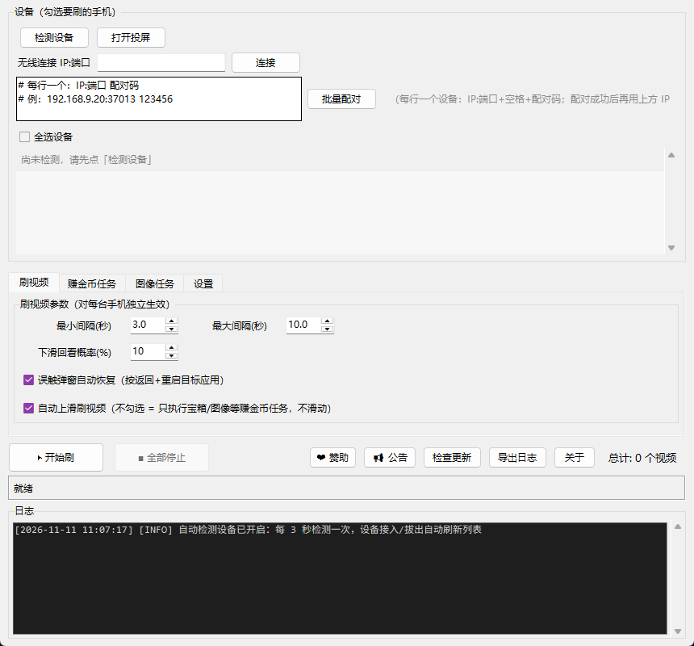

# 爽哥刷金币助手（多设备版）

> 挂在电脑上的安卓自动化小工具：通过 **adb** 模拟手指，帮你在抖音 / 快手 / 抖音极速版 / 快手极速版 / 微信视频号里**自动刷视频、自动赚金币、自动关广告**，支持多台手机同时跑，各自独立节奏。



**出品**：杨爽工作室 ｜ **平台**：Windows 10 / 11 ｜ **语言**：Python 3.12

---

## 核心思路

分工明确，互不干扰：

- **scrcpy** 只负责把手机画面投到电脑给你看
- **所有滑动与点击走 adb**（`exec-out screencap` + `input swipe/tap`）

所以关掉投屏窗口不影响自动化继续跑，也意味着**不依赖任何辅助服务框架**（无 Appium / 无 AccessibilityService），纯 adb 指令流。

---

## 功能特性

| 能力 | 说明 |
| --- | --- |
| 自动刷短视频 | 抖音 / 快手 / 抖音极速版 / 快手极速版 / 微信视频号通用，随机间隔上滑，模拟真人节奏 |
| 多设备同刷 | 一台电脑带多台手机，勾选哪几台刷哪几台，**每台独立线程、独立间隔、独立计数** |
| 自动签到 | 一键唤醒手机 → 打开 App → 点签到按钮 → 处理广告 |
| 定时点宝箱 | 每 N 分钟（默认 30，可调 5~240）自动点一次宝箱 |
| 图像任务 | 截图模板匹配找按钮，**按钮真出现了才点**，比固定坐标可靠 |
| 广告自动关闭 | 匹配到 × 关闭按钮就点掉，匹配不到走「误触自动恢复」兜底 |
| 界面异常自动纠正 | 定期截屏判断画面，遇到广告 / 弹窗 / 跑错 App / 回到桌面，自动按返回或重启 App |
| 防息屏 | 刷的期间临时把息屏时间调到 30 分钟，**停止后自动还原**原设置 |
| 离线语音控制 | 说「小金币 小金币」两次唤醒，再说「开始」/「停止」，全程不联网 |
| 语音提醒 | 设备上下线、设备异常用电脑语音播报，挂机不用盯屏 |
| 检查更新 / 启动公告 | 打开就知道有没有新版、有没有新通知，远程热更不用升级软件 |

### 图像任务五种模板类型

| 类型 | 行为 |
| --- | --- |
| 任务按钮 | 画面里出现就点（如「开」状态的宝箱按钮） |
| 广告关闭按钮 × | 广告关闭图标，标记为通用，所有广告场景共用 |
| 等待元素出现 | 先框选判断区域，再指定出现后动作（点另一位置 / 按返回键） |
| 等待元素消失 | 元素消失瞬间点它原来的位置（专治「X 秒后可开」倒计时） |
| 直播间 | 误入直播间自动按返回退出，优先级最高 |

每个模板支持**独立识别阈值**（0.50~0.98，默认 0.80）、**点击偏移**（按模板宽高百分比微调）、自定义分类目录。

---

## 环境要求

| 项 | 要求 |
| --- | --- |
| 系统 | Windows 10 / 11 |
| Python | 3.12（源码运行需要） |
| 依赖 | `opencv-python`、`numpy`、`Pillow`、`sounddevice`、`pywin32`、`vosk`（语音可选） |
| 手机 | 已开启「开发者选项 → USB 调试」，使用前需解锁 |

本仓库**不含** `bin\`（adb + scrcpy 二进制，约 25MB）与 `models\`（vosk 中文模型，约 65MB），请按下文「第三方组件」自行获取后放到对应目录。

---

## 快速开始

### 方式一：源码运行

```bash
git clone <本仓库地址>
cd shuage-coin-helper-v2
pip install opencv-python numpy Pillow sounddevice pywin32 vosk

# 准备第三方二进制
#   bin\adb.exe、bin\AdbWinApi.dll、bin\AdbWinUsbApi.dll   ← platform-tools
#   bin\scrcpy.exe、bin\SDL3.dll、bin\av*.dll、...          ← scrcpy release

python 爽哥刷金币助手.py
```

也可以双击 `启动爽哥刷金币助手_源码版.bat`（内部已绑定 Python 3.12 的 `pythonw.exe`，无黑窗）。

### 方式二：免安装包

```bash
pyinstaller shuage_v2.spec
# 产物：dist\ShuageCoinHelperV2\，把 bin\ 与 models\ 复制进去即可双击运行
```

### 三步上手

1. **连接**：点「检测设备」（无线设备先填 `IP:5555` 点「连接」）→ 设备出现在列表并勾选
2. **开 App**：手机打开抖音或快手，停在刷视频的界面
3. **开刷**：点「▶ 开始刷」→ 3 秒后手机开始自己滑

> 目标应用 = 点「开始刷」那一刻手机前台的那个 App。中途被广告顶走会识别并自动拉回来，期间不刷也不计数。

---

## 目录结构

```
shuage-coin-helper-v2/
├── 爽哥刷金币助手.py          # 主入口（MixIn 组合式架构）
├── modules/                   # 核心模块（纯 Python 源码）
│   ├── constants.py           # 版本、远程地址、阈值、应用名映射
│   ├── app_config.py          # 配置读写、旧配置迁移、模板路径解析
│   ├── devices.py             # 设备检测、无线连接/配对、备注、单台暂停
│   ├── swipe.py               # 刷视频主循环、图像任务、坐标采集、模板管理
│   ├── ui.py                  # 界面构建、关于/公告/更新/赞助
│   ├── voice_config.py        # 语音控制与语音提醒配置
│   ├── speech.py              # 语音播报封装
│   ├── scrcpy.py              # 投屏进程管理
│   ├── adb_utils.py / logger.py / utils.py
├── bin/                       # [不入库] adb + scrcpy 及依赖 DLL
├── models/                    # [不入库] vosk 中文离线模型
├── templates/                 # [不入库] 采集的图像模板（按应用分包）
├── website/                   # [不入库] 官网静态站与部署资源
├── docs/                      # 项目介绍、开发文档、复刻说明
├── 爽哥刷金币助手使用说明.md      # 完整使用手册
├── 版本信息.txt                # 打包用版本资源
├── shuage_v2.spec             # PyInstaller 打包配置
└── 启动爽哥刷金币助手_源码版.bat
```

配置文件 `爽哥刷金币助手配置.json` 与 `templates\` 必须与主程序同目录，会在首次启动时**自动生成**，配置损坏也会自愈重建。

---

## 第三方组件

| 组件 | 用途 | 获取方式 | 协议 |
| --- | --- | --- | --- |
| adb (platform-tools) | 设备通信与指令注入 | developer.android.com/studio/releases/platform-tools | Google SDK 条款 |
| scrcpy | 手机画面投屏 | github.com/Genymobile/scrcpy | Apache-2.0 |
| vosk + vosk-model-small-cn-0.22 | 离线中文语音识别 | alphacephei.com/vosk | Apache-2.0 |
| OpenCV / NumPy / Pillow | 模板匹配与图像处理 | PyPI | BSD / Apache-2.0 / HPND |
| sounddevice / pywin32 | 音频采集、系统语音 | PyPI | MIT / PSF |

`bin\` 与 `models\` 由使用者自行下载放置，本仓库不随附分发。

---

## 文档

| 文档 | 内容 |
| --- | --- |
| [爽哥刷金币助手使用说明.md](爽哥刷金币助手使用说明.md) | 完整使用手册（界面逐项、语音控制、常见问题） |
| [docs/项目介绍.md](docs/项目介绍.md) | 能力全景与设计说明 |
| [docs/DEVELOPMENT.md](docs/DEVELOPMENT.md) | 开发与模块说明 |
| [docs/复刻说明_V2.md](docs/复刻说明_V2.md) | 源码版与编译版的差异、构建要点 |

---

## 免责声明

1. 本项目**仅供学习与个人研究**使用，用于理解 adb 自动化、图像模板匹配与多线程调度的实现方式。
2. 高频点赞 / 关注类自动化**未提供也不建议实现**——属于平台风控重点，可能导致限流或封号。
3. 使用本工具产生的任何后果（账号异常、数据丢失、收益损失等）由使用者自行承担，作者不承担任何责任。
4. 请遵守抖音、快手、微信等平台的用户协议及当地法律法规。**请勿用于任何商业牟利或违规用途。**
5. 防息屏功能会临时修改手机息屏时间，停止时自动还原；进程被强杀后请手动检查手机息屏设置。

---

## 作者

**杨爽工作室** ｜ Copyright © 杨爽工作室

开源协议详见 [LICENSE](LICENSE)。
